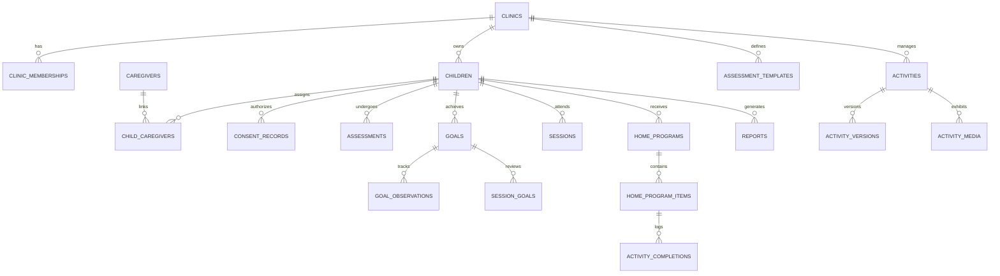

# Zeta Heal (OT Pathway) - Database Schema Specification

## 1. Schema Design Principles
1. **Multi-Tenant Isolation**: Strict `clinic_id` scoping on all clinic resources with PostgreSQL Row Level Security (RLS).
2. **Immutability of Clinical Artifacts**: 
   - Finalized assessments cannot be altered in place; amendments require versioning.
   - Published home program items store an immutable snapshot of activity instructions so library edits do not alter historical assignments.
3. **Auditability**: Every mutation produces a non-updatable `audit_events` record.
4. **Data Minimization**: Child records use internal UUIDs with pseudonymous handles. Sensitive notes are shielded by role-based RLS.

---

## 2. Entity Relationship Diagram (ERD)



---

## 3. Table Definitions & Constraints

### 3.1 Tenant & Identity

#### `clinics`
```sql
CREATE TABLE clinics (
    id UUID PRIMARY KEY DEFAULT gen_random_uuid(),
    name VARCHAR(255) NOT NULL,
    subdomain VARCHAR(63) UNIQUE,
    contact_email VARCHAR(255) NOT NULL,
    contact_phone VARCHAR(50),
    address JSONB,
    timezone VARCHAR(50) DEFAULT 'Asia/Kolkata',
    default_language VARCHAR(10) DEFAULT 'en',
    created_at TIMESTAMPTZ DEFAULT NOW(),
    updated_at TIMESTAMPTZ DEFAULT NOW()
);
```

#### `user_profiles`
```sql
CREATE TABLE user_profiles (
    id UUID PRIMARY KEY REFERENCES auth.users(id) ON DELETE CASCADE,
    display_name VARCHAR(255) NOT NULL,
    email VARCHAR(255) UNIQUE NOT NULL,
    phone_number VARCHAR(50),
    avatar_url TEXT,
    language_preference VARCHAR(10) DEFAULT 'en',
    created_at TIMESTAMPTZ DEFAULT NOW(),
    updated_at TIMESTAMPTZ DEFAULT NOW()
);
```

#### `clinic_memberships`
```sql
CREATE TYPE membership_role AS ENUM ('clinic_owner', 'occupational_therapist', 'clinic_admin');
CREATE TYPE membership_status AS ENUM ('invited', 'active', 'deactivated');

CREATE TABLE clinic_memberships (
    id UUID PRIMARY KEY DEFAULT gen_random_uuid(),
    clinic_id UUID NOT NULL REFERENCES clinics(id) ON DELETE CASCADE,
    user_id UUID NOT NULL REFERENCES user_profiles(id) ON DELETE CASCADE,
    role membership_role NOT NULL DEFAULT 'occupational_therapist',
    status membership_status NOT NULL DEFAULT 'active',
    created_at TIMESTAMPTZ DEFAULT NOW(),
    updated_at TIMESTAMPTZ DEFAULT NOW(),
    UNIQUE (clinic_id, user_id)
);
```

### 3.2 Patient, Caregiver & Consent

#### `children`
```sql
CREATE TYPE record_status AS ENUM ('active', 'inactive', 'archived');

CREATE TABLE children (
    id UUID PRIMARY KEY DEFAULT gen_random_uuid(),
    clinic_id UUID NOT NULL REFERENCES clinics(id) ON DELETE CASCADE,
    first_name VARCHAR(100) NOT NULL,
    last_name VARCHAR(100) NOT NULL,
    date_of_birth DATE NOT NULL,
    gender VARCHAR(30),
    clinical_history TEXT,
    functional_concerns TEXT,
    background_information TEXT,
    assigned_therapist_id UUID REFERENCES user_profiles(id) ON DELETE SET NULL,
    status record_status NOT NULL DEFAULT 'active',
    created_at TIMESTAMPTZ DEFAULT NOW(),
    updated_at TIMESTAMPTZ DEFAULT NOW()
);
CREATE INDEX idx_children_clinic ON children(clinic_id);
```

#### `caregivers`
```sql
CREATE TABLE caregivers (
    id UUID PRIMARY KEY DEFAULT gen_random_uuid(),
    user_id UUID REFERENCES user_profiles(id) ON DELETE CASCADE,
    email VARCHAR(255) NOT NULL,
    phone_number VARCHAR(50),
    preferred_contact_method VARCHAR(20) DEFAULT 'email',
    created_at TIMESTAMPTZ DEFAULT NOW(),
    updated_at TIMESTAMPTZ DEFAULT NOW()
);
```

#### `child_caregivers`
```sql
CREATE TYPE caregiver_relationship AS ENUM ('mother', 'father', 'grandparent', 'guardian', 'other');
CREATE TYPE link_status AS ENUM ('invited', 'active', 'revoked');

CREATE TABLE child_caregivers (
    id UUID PRIMARY KEY DEFAULT gen_random_uuid(),
    child_id UUID NOT NULL REFERENCES children(id) ON DELETE CASCADE,
    caregiver_id UUID NOT NULL REFERENCES caregivers(id) ON DELETE CASCADE,
    relationship caregiver_relationship NOT NULL,
    invite_token VARCHAR(128) UNIQUE,
    invite_expires_at TIMESTAMPTZ,
    status link_status NOT NULL DEFAULT 'invited',
    can_view_progress BOOLEAN DEFAULT TRUE,
    created_at TIMESTAMPTZ DEFAULT NOW(),
    updated_at TIMESTAMPTZ DEFAULT NOW(),
    UNIQUE (child_id, caregiver_id)
);
```

#### `consent_records`
```sql
CREATE TYPE consent_status AS ENUM ('granted', 'withdrawn', 'expired');

CREATE TABLE consent_records (
    id UUID PRIMARY KEY DEFAULT gen_random_uuid(),
    child_id UUID NOT NULL REFERENCES children(id) ON DELETE CASCADE,
    caregiver_id UUID NOT NULL REFERENCES caregivers(id) ON DELETE CASCADE,
    purpose VARCHAR(255) NOT NULL, -- e.g., 'pediatric_therapy_and_care_coordination'
    status consent_status NOT NULL DEFAULT 'granted',
    version VARCHAR(20) NOT NULL DEFAULT '1.0',
    recorded_at TIMESTAMPTZ DEFAULT NOW(),
    withdrawn_at TIMESTAMPTZ
);
```

### 3.3 Assessments

#### `assessment_templates` & `assessment_template_versions`
```sql
CREATE TABLE assessment_templates (
    id UUID PRIMARY KEY DEFAULT gen_random_uuid(),
    clinic_id UUID REFERENCES clinics(id) ON DELETE CASCADE, -- NULL for system templates
    title VARCHAR(255) NOT NULL,
    description TEXT,
    category VARCHAR(100),
    is_active BOOLEAN DEFAULT TRUE,
    created_at TIMESTAMPTZ DEFAULT NOW()
);

CREATE TABLE assessment_template_versions (
    id UUID PRIMARY KEY DEFAULT gen_random_uuid(),
    template_id UUID NOT NULL REFERENCES assessment_templates(id) ON DELETE CASCADE,
    version_number INT NOT NULL,
    form_schema JSONB NOT NULL, -- field definitions, types, required rules
    scoring_rules JSONB,
    instructions TEXT,
    created_at TIMESTAMPTZ DEFAULT NOW(),
    UNIQUE(template_id, version_number)
);
```

#### `assessments` & `assessment_responses`
```sql
CREATE TYPE assessment_status AS ENUM ('draft', 'in_progress', 'finalized', 'amended');

CREATE TABLE assessments (
    id UUID PRIMARY KEY DEFAULT gen_random_uuid(),
    clinic_id UUID NOT NULL REFERENCES clinics(id) ON DELETE CASCADE,
    child_id UUID NOT NULL REFERENCES children(id) ON DELETE CASCADE,
    therapist_id UUID NOT NULL REFERENCES user_profiles(id),
    template_version_id UUID NOT NULL REFERENCES assessment_template_versions(id),
    status assessment_status NOT NULL DEFAULT 'draft',
    assessment_date DATE NOT NULL,
    clinical_interpretation TEXT,
    next_review_date DATE,
    finalized_at TIMESTAMPTZ,
    created_at TIMESTAMPTZ DEFAULT NOW(),
    updated_at TIMESTAMPTZ DEFAULT NOW()
);

CREATE TABLE assessment_responses (
    id UUID PRIMARY KEY DEFAULT gen_random_uuid(),
    assessment_id UUID NOT NULL REFERENCES assessments(id) ON DELETE CASCADE,
    field_id VARCHAR(100) NOT NULL,
    field_label TEXT NOT NULL,
    response_value JSONB NOT NULL,
    score NUMERIC,
    notes TEXT,
    created_at TIMESTAMPTZ DEFAULT NOW(),
    UNIQUE(assessment_id, field_id)
);
```

### 3.4 Functional Goals & Observations

#### `goals`
```sql
CREATE TYPE goal_domain AS ENUM (
    'fine_motor', 
    'visual_motor', 
    'handwriting', 
    'self_care', 
    'feeding', 
    'play_participation', 
    'sensory_processing', 
    'functional_independence', 
    'other'
);
CREATE TYPE goal_status AS ENUM ('draft', 'active', 'paused', 'achieved', 'discontinued');

CREATE TABLE goals (
    id UUID PRIMARY KEY DEFAULT gen_random_uuid(),
    clinic_id UUID NOT NULL REFERENCES clinics(id) ON DELETE CASCADE,
    child_id UUID NOT NULL REFERENCES children(id) ON DELETE CASCADE,
    responsible_therapist_id UUID NOT NULL REFERENCES user_profiles(id),
    domain goal_domain NOT NULL,
    title VARCHAR(255) NOT NULL,
    functional_description TEXT NOT NULL,
    baseline_value TEXT NOT NULL,
    baseline_numeric NUMERIC,
    target_value TEXT NOT NULL,
    target_numeric NUMERIC,
    measurement_unit VARCHAR(50),
    status goal_status NOT NULL DEFAULT 'draft',
    start_date DATE NOT NULL,
    target_review_date DATE,
    achieved_date DATE,
    notes TEXT,
    created_at TIMESTAMPTZ DEFAULT NOW(),
    updated_at TIMESTAMPTZ DEFAULT NOW()
);
CREATE INDEX idx_goals_child ON goals(child_id);
```

#### `goal_observations`
```sql
CREATE TYPE observation_source AS ENUM ('therapist_in_clinic', 'caregiver_home_log', 'standardized_retest');

CREATE TABLE goal_observations (
    id UUID PRIMARY KEY DEFAULT gen_random_uuid(),
    goal_id UUID NOT NULL REFERENCES goals(id) ON DELETE CASCADE,
    recorded_by UUID NOT NULL REFERENCES user_profiles(id),
    observation_date DATE NOT NULL,
    source observation_source NOT NULL DEFAULT 'therapist_in_clinic',
    measured_numeric NUMERIC,
    measured_qualitative TEXT,
    clinical_notes TEXT,
    created_at TIMESTAMPTZ DEFAULT NOW()
);
```

### 3.5 Sessions

#### `sessions` & `session_goals`
```sql
CREATE TYPE session_status AS ENUM ('draft', 'completed', 'cancelled');

CREATE TABLE sessions (
    id UUID PRIMARY KEY DEFAULT gen_random_uuid(),
    clinic_id UUID NOT NULL REFERENCES clinics(id) ON DELETE CASCADE,
    child_id UUID NOT NULL REFERENCES children(id) ON DELETE CASCADE,
    therapist_id UUID NOT NULL REFERENCES user_profiles(id),
    session_date DATE NOT NULL,
    duration_minutes INT DEFAULT 45,
    status session_status NOT NULL DEFAULT 'draft',
    objective_observations TEXT,
    assistance_level VARCHAR(100), -- Independent, Moderate, Maximum, Hand-over-hand
    intervention_response TEXT,
    plan_for_next_session TEXT,
    created_at TIMESTAMPTZ DEFAULT NOW(),
    updated_at TIMESTAMPTZ DEFAULT NOW()
);

CREATE TABLE session_goals (
    id UUID PRIMARY KEY DEFAULT gen_random_uuid(),
    session_id UUID NOT NULL REFERENCES sessions(id) ON DELETE CASCADE,
    goal_id UUID NOT NULL REFERENCES goals(id) ON DELETE CASCADE,
    progress_notes TEXT,
    assistance_given VARCHAR(100),
    UNIQUE (session_id, goal_id)
);
```

### 3.6 Activity Library & Home Programs

#### `activities` & `activity_versions`
```sql
CREATE TYPE activity_status AS ENUM ('draft', 'published', 'archived');

CREATE TABLE activities (
    id UUID PRIMARY KEY DEFAULT gen_random_uuid(),
    clinic_id UUID REFERENCES clinics(id) ON DELETE CASCADE, -- NULL for global curated library
    title VARCHAR(255) NOT NULL,
    category VARCHAR(100) NOT NULL,
    description TEXT NOT NULL,
    instructions TEXT NOT NULL,
    functional_purpose TEXT NOT NULL,
    materials_needed TEXT,
    estimated_duration_minutes INT DEFAULT 15,
    suggested_frequency VARCHAR(100) DEFAULT '3 times per week',
    difficulty_level VARCHAR(50) DEFAULT 'moderate',
    safety_guidance TEXT,
    supervision_guidance TEXT,
    status activity_status NOT NULL DEFAULT 'published',
    created_at TIMESTAMPTZ DEFAULT NOW(),
    updated_at TIMESTAMPTZ DEFAULT NOW()
);

CREATE TABLE activity_media (
    id UUID PRIMARY KEY DEFAULT gen_random_uuid(),
    activity_id UUID NOT NULL REFERENCES activities(id) ON DELETE CASCADE,
    media_url TEXT NOT NULL,
    media_type VARCHAR(50) NOT NULL, -- 'image', 'video_link'
    caption TEXT,
    display_order INT DEFAULT 0
);
```

#### `home_programs` & `home_program_items`
```sql
CREATE TYPE program_status AS ENUM ('draft', 'published', 'paused', 'completed', 'archived');

CREATE TABLE home_programs (
    id UUID PRIMARY KEY DEFAULT gen_random_uuid(),
    clinic_id UUID NOT NULL REFERENCES clinics(id) ON DELETE CASCADE,
    child_id UUID NOT NULL REFERENCES children(id) ON DELETE CASCADE,
    therapist_id UUID NOT NULL REFERENCES user_profiles(id),
    title VARCHAR(255) NOT NULL,
    notes_for_caregiver TEXT,
    status program_status NOT NULL DEFAULT 'draft',
    start_date DATE NOT NULL,
    end_date DATE,
    published_at TIMESTAMPTZ,
    created_at TIMESTAMPTZ DEFAULT NOW(),
    updated_at TIMESTAMPTZ DEFAULT NOW()
);

CREATE TABLE home_program_items (
    id UUID PRIMARY KEY DEFAULT gen_random_uuid(),
    home_program_id UUID NOT NULL REFERENCES home_programs(id) ON DELETE CASCADE,
    activity_id UUID REFERENCES activities(id) ON DELETE SET NULL,
    linked_goal_id UUID REFERENCES goals(id) ON DELETE SET NULL,
    -- Immutable assignment snapshot:
    snapshot_title VARCHAR(255) NOT NULL,
    snapshot_instructions TEXT NOT NULL,
    snapshot_materials TEXT,
    prescribed_frequency VARCHAR(100) NOT NULL,
    prescribed_duration_minutes INT NOT NULL,
    special_caregiver_notes TEXT,
    display_order INT DEFAULT 0,
    created_at TIMESTAMPTZ DEFAULT NOW()
);
```

#### `activity_completions`
```sql
CREATE TYPE completion_status AS ENUM ('completed', 'partially_completed', 'not_completed');

CREATE TABLE activity_completions (
    id UUID PRIMARY KEY DEFAULT gen_random_uuid(),
    home_program_item_id UUID NOT NULL REFERENCES home_program_items(id) ON DELETE CASCADE,
    caregiver_id UUID NOT NULL REFERENCES caregivers(id) ON DELETE CASCADE,
    completion_date DATE NOT NULL,
    status completion_status NOT NULL,
    difficulty_experienced VARCHAR(50), -- 'too_easy', 'just_right', 'challenging', 'frustrating'
    child_engagement VARCHAR(50), -- 'enthusiastic', 'cooperative', 'reluctant', 'refused'
    assistance_needed VARCHAR(50), -- 'independent', 'minimal_help', 'full_assistance'
    caregiver_observations TEXT,
    reason_not_completed TEXT,
    idempotency_key VARCHAR(128) UNIQUE,
    created_at TIMESTAMPTZ DEFAULT NOW()
);
CREATE INDEX idx_completions_item ON activity_completions(home_program_item_id);
```

### 3.7 Outcome Reports, Notifications & Auditing

#### `reports` & `report_versions`
```sql
CREATE TYPE report_type AS ENUM (
    'initial_assessment', 
    'goal_progress', 
    'home_adherence', 
    'periodic_clinical_review', 
    'parent_friendly_summary'
);

CREATE TABLE reports (
    id UUID PRIMARY KEY DEFAULT gen_random_uuid(),
    clinic_id UUID NOT NULL REFERENCES clinics(id) ON DELETE CASCADE,
    child_id UUID NOT NULL REFERENCES children(id) ON DELETE CASCADE,
    author_id UUID NOT NULL REFERENCES user_profiles(id),
    title VARCHAR(255) NOT NULL,
    report_type report_type NOT NULL,
    period_start DATE NOT NULL,
    period_end DATE NOT NULL,
    clinical_narrative TEXT,
    parent_accessible BOOLEAN DEFAULT FALSE,
    pdf_storage_path TEXT,
    created_at TIMESTAMPTZ DEFAULT NOW()
);
```

#### `notifications`
```sql
CREATE TABLE notifications (
    id UUID PRIMARY KEY DEFAULT gen_random_uuid(),
    recipient_user_id UUID NOT NULL REFERENCES user_profiles(id) ON DELETE CASCADE,
    title VARCHAR(255) NOT NULL,
    body TEXT NOT NULL,
    category VARCHAR(50) NOT NULL, -- 'program_published', 'activity_reminder', 'caregiver_feedback'
    metadata JSONB,
    read_at TIMESTAMPTZ,
    created_at TIMESTAMPTZ DEFAULT NOW()
);
```

#### `audit_events`
```sql
CREATE TABLE audit_events (
    id UUID PRIMARY KEY DEFAULT gen_random_uuid(),
    clinic_id UUID REFERENCES clinics(id) ON DELETE CASCADE,
    actor_id UUID REFERENCES user_profiles(id) ON DELETE SET NULL,
    actor_role VARCHAR(50) NOT NULL,
    action VARCHAR(100) NOT NULL,
    entity_type VARCHAR(100) NOT NULL,
    entity_id UUID NOT NULL,
    metadata JSONB,
    ip_address INET,
    user_agent TEXT,
    created_at TIMESTAMPTZ DEFAULT NOW()
);
CREATE INDEX idx_audit_clinic ON audit_events(clinic_id);
```
