# Zeta Heal (OT Pathway) - VPS Deployment & Automated CI/CD Guide

This guide explains how to deploy **Zeta Heal** to your VPS hosting using Docker Compose and an automatic GitHub Actions deployment pipeline.

---

## 1. Architecture of the Deployment Pipeline

```mermaid
graph LR
    Dev[Developer] -->|git push origin main| GH[GitHub Repository<br/>datech-dev/zetaheal]
    GH -->|Triggers Workflow| GHA[GitHub Actions CI/CD]
    
    subgraph CI Quality Gates
        GHA -->|1. Build Packages| T1[npm run build:packages]
        T1 -->|2. Run Tests| T2[npm test]
        T2 -->|3. Typecheck| T3[npm run typecheck]
        T3 -->|4. Next.js Build| T4[npm run build:web]
    end
    
    subgraph CD Automated Deploy
        T4 -->|SSH to VPS via Secret Keys| VPS[Your VPS Server]
        VPS -->|git pull latest| GIT[Git Working Copy]
        GIT -->|docker compose up -d --build| DOCKER[Docker Containers<br/>Web + Nginx Reverse Proxy]
        DOCKER -->|Health Check| READY[Active Production App]
    end
```



---

## 2. Part 1: Initial VPS Setup (One-Time Setup)

Connect to your VPS via SSH from your terminal:
```bash
ssh root@YOUR_VPS_IP
```

### Step 1: Install Docker & Git
On Ubuntu/Debian, run:
```bash
sudo apt update && sudo apt upgrade -y
sudo apt install -y git curl ufw docker.io docker-compose-v2

# Enable and start Docker service
sudo systemctl enable --now docker
```

### Step 2: Configure Firewall (UFW)
Allow SSH, HTTP (Port 80), and HTTPS (Port 443):
```bash
sudo ufw allow OpenSSH
sudo ufw allow 80/tcp
sudo ufw allow 443/tcp
sudo ufw --force enable
```

### Step 3: Clone Repository on VPS
Create directory and clone the repository:
```bash
sudo mkdir -p /var/www/zetaheal
sudo chown -R $USER:$USER /var/www/zetaheal

git clone https://github.com/datech-dev/zetaheal.git /var/www/zetaheal
cd /var/www/zetaheal
```

### Step 4: Configure Production Environment Variables
Copy `.env.example` to `.env`:
```bash
cp .env.example .env
nano .env
```
Ensure `NEXT_PUBLIC_SITE_URL` is set to your VPS domain or IP (e.g., `https://your-domain.com` or `http://YOUR_VPS_IP`).

### Step 5: Test Initial Manual Start
Verify that Docker Compose builds and starts the application cleanly:
```bash
docker compose up -d --build
```
Check container status:
```bash
docker compose ps
docker compose logs -f web
```
You can now visit `http://YOUR_VPS_IP` in your browser to verify Zeta Heal is online!

---

## 3. Part 2: Setting Up the Automatic GitHub Actions Pipeline

Whenever you push to the `main` branch, GitHub Actions will:
1. Run linting, TypeScript strict checking, and all 10 clinical & security tests.
2. Build the Next.js bundle to confirm zero build errors.
3. Securely SSH into your VPS, pull the latest commit, rebuild the containers, and run a health check.

### Step 1: Generate an SSH Key Pair for GitHub Actions
On your VPS (or local terminal), generate an SSH key:
```bash
ssh-keygen -t ed25519 -C "github-actions-zetaheal" -f ~/.ssh/github_actions_zetaheal -N ""
```

Add the public key to `~/.ssh/authorized_keys` on your VPS:
```bash
cat ~/.ssh/github_actions_zetaheal.pub >> ~/.ssh/authorized_keys
chmod 600 ~/.ssh/authorized_keys
```

Display the private key (you will copy this to GitHub):
```bash
cat ~/.ssh/github_actions_zetaheal
```

### Step 2: Add Secrets to Your GitHub Repository
1. Open your repository on GitHub: [https://github.com/datech-dev/zetaheal](https://github.com/datech-dev/zetaheal)
2. Go to **Settings** > **Secrets and variables** > **Actions**.
3. Click **New repository secret** and add the following 4 secrets:

| Secret Name | Value Example | Description |
| :--- | :--- | :--- |
| `VPS_HOST` | `123.45.67.89` (or `zetaheal.yourdomain.com`) | Your VPS Public IP Address |
| `VPS_USERNAME` | `root` (or `ubuntu`) | SSH user on your VPS |
| `VPS_SSH_KEY` | Contents of `~/.ssh/github_actions_zetaheal` | Private SSH key (including BEGIN and END lines) |
| `VPS_PORT` | `22` | SSH port (default is 22) |
| `VPS_APP_DIR` | `/var/www/zetaheal` | Deployment path on VPS |

That's it! Every future `git push origin main` will now deploy automatically.

---

## 4. Part 3: Adding Free SSL (HTTPS) with Let's Encrypt

Once your domain DNS A-record points to your VPS IP:

1. Request your certificate using Certbot:
```bash
cd /var/www/zetaheal
docker compose run --rm --entrypoint "\
  certbot certonly --webroot -w /var/www/certbot \
  --email your-email@example.com \
  --agree-tos --no-eff-email \
  -d yourdomain.com -d www.yourdomain.com" certbot
```

2. Uncomment the HTTPS server block in `nginx/nginx.conf` and update `yourdomain.com`.
3. Restart Nginx:
```bash
docker compose restart nginx
```

---

## 5. Maintenance & Useful Commands on VPS

| Operation | Command |
| :--- | :--- |
| **View Web Application Logs** | `docker compose logs -f web` |
| **View Nginx Logs** | `docker compose logs -f nginx` |
| **Restart Application** | `docker compose restart` |
| **Manual Deploy Trigger** | `./deploy.sh` |
| **Check Container Health** | `docker compose ps` |
| **Prune Old Docker Images** | `docker image prune -f` |
